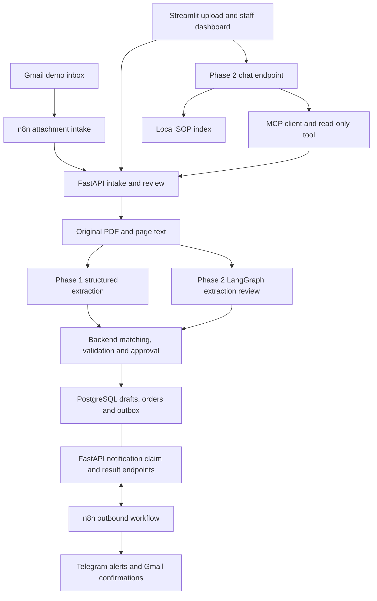

# Wave 5 | AI Purchase Order Intake & Staff Assistant

## Product and demo goal

Meridian Industrial Supply is a fictional Malaysian B2B supplier. Its sales operations staff receive customer purchase orders (POs) as PDF attachments. Today a staff member reads each PDF, identifies the customer and products, checks the agreed unit prices, and enters the order. This application prepares that review and creates a real sales order in the demo database when a staff member approves.

Build around two questions a reviewer should be able to answer on one screen:

- **Where did this value come from?** Beside each extracted field, show the PDF page, verified excerpt, and any expected value. A staff member can distinguish a reading error from a customer who actually ordered at the wrong price.
- **What happened when the customer sent another file?** Show whether it was an exact resend, an equivalent regenerated document, a proposed revision, or an unresolved match. Show which version staff approved and which sales order it produced.

The portfolio evidence is a repeatable walkthrough, database-backed outcomes, and measured results on synthetic examples. A correctly escalated ambiguity is a successful outcome.

## Decisions, assumptions, and implementation checks

| Status | Decision and reason |
|---|---|
| Agreed | Use Python, FastAPI, Pydantic, PostgreSQL, SQLAlchemy, Alembic, PyMuPDF, Streamlit, and pytest. Use Gmail and n8n for email intake, Telegram for exception alerts, and Gmail for confirmations. Store original PDF bytes in a local directory or mounted volume. |
| Agreed | Phase 1 uses one structured extraction call as its baseline. Phase 2 adds LangGraph extraction review and then a read-only MCP and SOP chat feature. Models propose fields and answers. Backend rules determine eligibility, and staff authorizes the order. |
| Demo assumptions | One supplier, MYR (RM), positive whole-unit quantities, two-decimal nonnegative unit prices, and one seeded agreed price per customer and SKU. Use text-based PDFs. Flag unsupported currencies, units, price precision, or unreadable pages for review. Tax, discounts, OCR, ERP posting, and amendments to confirmed orders are outside this demo. |
| Reversible defaults | Use a named local staff identity, a dedicated demo inbox, seeded customer references, approved test sender/recipient mappings, and a private Telegram chat. Limit the dashboard and API to the configured demo environment. The named reviewer is sufficient for a local audit trail. |
| Verify during implementation | Start with a Qwen candidate through Ollama. On development fixtures, compare schema validity, evidence quality, latency, and whether it fits the actual Windows machine. Record the model tag, settings, runner version, and reason for the choice. Use a stub for engineering tests and demonstrate a real local model call before closing Milestone 1. |
| Verify during implementation | Try heading-based SOP chunks and a small local lexical index first. Check retrieval on development questions, including paraphrases. Add local embeddings only if the results justify them. Record the chosen method, settings, and corpus version before held-out evaluation. |

## Architecture and ownership

FastAPI owns intake, validation, staff review, and order creation. Both the local upload and the Milestone 3 n8n inbox workflow call the same intake service. The inbox workflow watches a dedicated Gmail label and passes PDF bytes, message ID, attachment ID, and sender metadata. A separate outbound n8n workflow claims notification intents from FastAPI, sends the approved payloads, and reports outcomes. PostgreSQL holds the authoritative state.

In Milestones 1 and 2, FastAPI runs extraction in a foreground request. In Milestone 3, a durable extraction worker in the same codebase uses PostgreSQL jobs and leases to run the same extraction function. Streamlit reads and writes through FastAPI. Use a read-only PDF endpoint with a page selector so staff can inspect evidence against the original. The SOP index contains only versioned demo SOPs. Live PO facts come from the backend.

## Phase 1 | From receipt to confirmed order

### 1. Accept and extract

1. Stage and hash the PDF, verify the completed file, and atomically publish it under its SHA-256. Commit the receipt in `pending` state before extraction. Return its intake ID. In Milestones 1 and 2, the local UI then calls a synchronous process endpoint for that ID. Persist `processing`, run Ollama outside the database transaction, and commit the outcome. If the browser closes between requests, staff can open the pending receipt and process it. A retry reuses the stored bytes.
2. Extract and preserve text by **one-based PDF page number**. Give the model numbered pages and a structured schema for PO number, customer reference, currency, and ordered lines with SKU, quantity, and unit price. Request nullable values, alternatives where genuinely ambiguous, and page/excerpt per field. Preserve raw tokens such as “RM90.00”. Treat document text as data throughout.
3. Parse with Pydantic. Verify each proposed excerpt on the stated page using documented normalization limited to whitespace and line wrapping. Keep a match location. Repeated text with unclear row association, absent text, or a value unsupported by the quote gets a visible evidence issue. A matching quote alone cannot establish which line or price column it describes. Never display a fabricated quote as verified. A staff member can inspect the original and record the page, supported value, and reason.
4. Empty or image-only pages that may contain order details go to review. On a handled technical failure, persist `failed`, the attempt time, and an error summary visible in the dashboard. **Retry extraction** starts another foreground attempt on the same intake. If the local API process dies mid-call, the receipt may still say `processing`. After confirming the old process stopped, staff can mark that attempt interrupted and retry manually. In Milestone 3, commit a durable extraction job with each accepted receipt that needs processing. A worker claims it under a lease, recovers expired claims, and retries transient failures within a configured limit. Only the current attempt can publish results.

### 2. Match and validate

Resolve an explicit customer reference against seeded aliases. For email, require its configured sender mapping to agree. For upload, a staff-selected customer can confirm context. Conflicts, unknown references, missing PO numbers, or several possible matches stay in the intake review queue. Show candidates and the reason for uncertainty. Staff must resolve identity with evidence before linking or creating a PO. Keep identity changes auditable and run matching again.

Use the verified customer ID and conservatively normalized PO number as the business key. Trim surrounding whitespace and normalize case for the demo. Preserve the displayed original, punctuation, and leading zeros. Resolve SKU by exact seeded code or unambiguous configured alias. Validate every line, positive quantity, currency, and existence of an agreed customer price. Parse money from text to Python `Decimal` and persist as PostgreSQL `NUMERIC`. Reject excess precision before storage. Never compare floats or round an invalid price into agreement.

| Issue class | Example | Staff action |
|---|---|---|
| Extraction or evidence | Model reports RM100. Page 1 clearly says RM90 for that SKU. | Correct the draft to RM90 with a page reference and reason. Keep the original extraction. Rerun validation. |
| Business mismatch | The PDF and draft both say RM90. The customer's price list says RM100. | Show actual RM90 and expected RM100. Keep approval blocked. Request a corrected customer PDF through the demo conversation. |
| Identity or revision | Sender and customer reference disagree, or the incoming document may repeat an earlier version. | Inspect both sources, resolve or defer the link, and record the decision. |
| Technical failure | Ollama times out before producing a draft. | Show a failed attempt in the intake queue. Retry the same intake after recovery. |

### 3. Decide what a second document means

Apply these rules in order. Keep one receipt per actual delivery, even when several receipts link to the same document.

| Input | Backend decision | What staff sees |
|---|---|---|
| Same Gmail message and attachment replayed by n8n | Return the existing receipt using its channel event key. | Same intake ID and outcome. |
| New delivery, byte-identical PDF | Link the new receipt to the existing intake/document when customer context is compatible. Reuse pending work if extraction is unfinished. A conflicting sender/customer context goes to identity review without exposing the other customer's PO. | Exact resend, original version link, unchanged order and notification counts. |
| New bytes, same verified business key, equivalent complete fields | Compare a canonical representation of currency and normalized line tuples, retaining multiplicity. Ignore layout, decimal formatting, and line order in this comparison. Keep the file and record an equivalent candidate. | Existing active version remains selected. Staff can inspect both originals. |
| New bytes, same verified business key, changed or uncertain fields | Store a candidate and show the diff. Missing values or unresolved evidence prevent an automatic equivalence decision. Staff can activate a supported revision or dismiss the candidate with a reason. | Old and proposed values by line and field. For repeated SKUs with uncertain alignment, show unmatched lines and require review. |
| Unresolved identity or several plausible POs | Keep the intake unlinked. Staff explicitly chooses an evidenced match or verifies a distinct PO. | Review queue shows possible matches. No automatic merge. |
| Changed document after order creation | Link as a post-order review item after identity is verified. Preserve the approved snapshot, order lines, and confirmation. | Confirmed order plus a separate open follow-up. No second order. |

A pending changed candidate **blocks approval** once linked to an open PO. Recheck that block under the same PO lock used for candidate activation and approval. A late arrival that loses the race to a committed approval follows the post-order rule. Exact and verified equivalent copies do not open a new exception episode. Content comparison is a review aid, never the business identity or permission to replace a version.

### 4. Review and approve one snapshot

The PO detail page shows original PDF, extracted draft, verified evidence, expected prices, open issues, revision history, and notification outcomes. Label customer documents V1, V2, and so on. Record a staff correction to the same PDF as a new immutable draft snapshot, for example **V1, edit 2**. Show who changed what and why. Staff may correct a reading to match the source. A price change requested from the customer requires a revised document. Keep the model's original output available.

Send the expected active snapshot ID with each correction, revision activation, and approval. Reject an edit based on a superseded snapshot so it cannot overwrite a more recent review. In one database transaction, lock the PO, compare the submitted ID with the active snapshot, check pending candidates, and rerun validation against the current price list. Reject a stale snapshot with HTTP 409 and a link to refresh. Persist fresh validation issues when a current snapshot fails. If eligible, insert approval, order header and lines, and, from Milestone 3, one confirmation intent. Commit before any external send. An identical retry for the already approved snapshot returns the existing order. A request for another snapshot cannot claim that approval.

### Workflow states

| Record | States and transitions |
|---|---|
| Intake work | `pending → processing → complete` or `failed`. Complete includes a stored draft needing review. In Milestones 1 and 2 staff manually retries failed or interrupted attempts. Milestone 3 adds bounded automatic retries and recovery of expired worker leases. |
| PO | `needs_review ↔ ready_for_approval → ordered`. An unresolved intake can exist before a PO does. A new blocker returns an open PO to review. An ordered PO keeps its status if a follow-up arrives. |
| Candidate disposition | Record the decision separately from PO status, e.g. pending review, equivalent, activated, dismissed, or post-order follow-up. Exact resends are receipt links. |
| Notification | `pending → sending → sent`, `failed`, or `unknown`. Failed means known non-delivery and may be retried. Unknown means delivery may already have occurred. Display channel, destination alias, attempt time, and outcome. |

### 5. Deliver notifications in Milestone 3

FastAPI writes a Telegram intent in the same transaction that opens a blocking review episode. Include the PO reference (or intake ID), short reason, and a dashboard link reachable from the demo device. Use one unique event key per review episode. Revalidation reuses the key. In the approval transaction, write one Gmail confirmation intent per sales order with both order numbers. FastAPI resolves the destination from configured test contacts and stores the channel, destination, and payload before dispatch.

1. A scheduled n8n workflow calls an authenticated FastAPI claim endpoint. FastAPI atomically changes one eligible intent from `pending` to `sending`, records the attempt ID and deadline, and returns its payload. Concurrent polls cannot claim that intent again.
2. n8n sends through the corresponding Telegram or Gmail node once per claimed attempt. Disable automatic retries on the provider-send step. POST the attempt ID, outcome, and available provider receipt back to FastAPI. A callback retry repeats only that POST. FastAPI applies it idempotently and rejects conflicting or superseded results.
3. FastAPI records `sent` on confirmed acceptance, `failed` on known non-delivery, and `unknown` on an ambiguous response or expired sending attempt. Only known non-delivery is eligible for bounded automatic retry. **If the provider accepts the send but its response is lost, delivery remains unknown.** Staff checks the test inbox, Sent folder, or Telegram chat and records the reconciliation before authorizing any resend. Repeating a send with unresolved delivery can deliver twice. The stored order retains its number and `ordered` status throughout.

## Minimum durable data

These are logical records. Use JSON for small Pydantic snapshots, evidence, and issue lists where relational querying adds little. Use foreign keys and database constraints for identity and order guarantees.

| Record | Minimum fields and constraints |
|---|---|
| Customer, SKU, agreed price | Stable IDs, unique references/aliases, configured test contact mapping. Unique price per customer, SKU, currency. |
| Document and intake receipt | Unique byte hash, relative storage path, size, page text. Receipt includes source, sender/context, timestamp, document ID, canonical intake link, and optional channel event key. Unique non-null channel event key per source. Concurrent local uploads can have separate receipts but must reuse canonical work in compatible context. |
| Extraction attempt | From Milestone 1, persist intake ID, pipeline, attempt ID, state, timestamps, error, model/settings, and available raw and parsed results. A conditional state update admits one current attempt per intake and pipeline. Milestone 3 adds durable job scheduling, lease expiry, a claim token, and retry count. A recovered job accepts results only from its current claim. |
| PO and document version | Unique verified customer ID + normalized PO number. PO holds active snapshot ID and status. Version links PO, document, intake, and candidate disposition. Unique version number per PO. Serialize identity creation using the unique key and retry lookup on conflict. |
| Draft snapshot and review history | Immutable snapshot ID, owning version, parent snapshot, line values, evidence/verification, author, timestamp and change reason. Store validation results with the expected values used and time checked. Ensure the active snapshot belongs to that PO. |
| Approval and sales order | Approval binds reviewer, timestamp, PO and snapshot. Order has unique sales order number, unique PO ID, approved snapshot reference, customer and copied lines/prices. Enforce one successful approval per PO. Both records must reference the same PO and snapshot. |
| Outbox (Milestone 3) | PostgreSQL stores the unique event key, related intake/PO/order, channel, configured destination, payload, delivery state, attempt ID/deadline, provider receipt, and outcome history. FastAPI alone writes these records. n8n uses claim and result endpoints. |

## Phase 2 | Two independent milestones

### LangGraph extraction review

Retain the Phase 1 extractor as a callable baseline. Route difficult cases into LangGraph using an explicit trigger such as unresolved line-to-price evidence or missing required fields on a multipage layout. Include a staff-triggered run for demonstration. An accurately extracted business price mismatch alone needs business review, not another model read.

1. The **Extraction Agent** receives numbered page text and the extraction schema. It proposes fields, line associations, candidate alternatives, and evidence. Persist that proposal in graph state.
2. The **Review Agent** makes a separate model call. It sees the proposal and source pages, checks disputed values and omissions, and returns a structured decision: `accept`, `reread`, or `escalate`, with reasons. A reread must name pages and fields and say what is unresolved.
3. Allow **one targeted reread per document**. Pass only the requested scope and review feedback to the Extraction Agent for a patch. Recheck the merged proposal with the Review Agent. A further reread request, invalid decision, or unresolved ambiguity escalates to staff. Bound call timeouts and retain the last usable draft on failure.
4. Store the trigger, handoffs, decisions, pages read, call count, and elapsed time. Both agents may use the same model. An accepted proposal still passes the Phase 1 evidence verifier and backend rules. Results for an existing review become candidate snapshots. An evaluation run never activates a snapshot or emits notifications.

### Selected-PO chat with MCP and SOP RAG

Open chat inside a PO detail page. Bind the request to the selected internal PO ID on the server. The chat backend uses an actual MCP client, discovers and calls a read-only tool such as `get_po_review_context` on a local MCP server, and that tool calls the backend read endpoint. Use a local stdio transport initially. Expose the actual tool name, arguments, and returned snapshot, status, issues, and checked/expected values in a collapsible trace. Include active document version, latest candidate disposition, snapshot ID, and read time so “latest” is unambiguous.

Index versioned synthetic SOP sections ahead of the demo. Keep document ID, revision, heading, section ID, and exact excerpt with each chunk. Retrieve relevant passages for procedural questions. Display **Live PO facts** with a PO/version reference and **SOP guidance** with a clickable or expandable passage. Show which checks remain for the human reviewer. Missing tool data, conflicting sources, or missing SOP coverage must be stated explicitly. Chat has read-only tools. Approval remains a dashboard action.

Seed a short SOP with an identifiable section such as **SOP-02 rev 1 §3, Pre-approval checks**. Its text should explicitly require checking customer reference, SKU, quantity, source support for corrected fields, and absence of unresolved issues. Include three acceptance questions:

| Question | Required observable behavior |
|---|---|
| “The price in V2 now matches. Under our SOP, what else do I need to check before approving?” | Fetch the selected PO through MCP, verify the premise against the active snapshot, report actual remaining issues, and cite the applicable SOP checklist. If the order is already approved, say so. |
| “Which unit price and revision are active on this PO?” | Use the live tool result and cite the PO/version. A procedural citation is unnecessary. |
| “Who can authorize a 15% price override?” | For a corpus with no delegation rule, state that the indexed SOPs do not establish an approver. Do not invent a person or permission. |

## Implementation milestones

Each row is an independent stopping point. Keep previous milestones runnable. Build later safeguards in the milestone that exercises them.

| Milestone | Scope | Codex verifies | Owner checks in the demo | Complete when |
|---|---|---|---|---|
| **1. Local order** | Persist a local PDF and receipt. Extract numbered pages with real Ollama in a foreground request. Validate against seeded customer/SKU prices, review the draft, approve its snapshot, and store a sales order. Include manual retry and the unique order constraint. | Migrate an empty PostgreSQL database. Force an Ollama failure, restart the API, and verify the saved error and original PDF. Retry the same intake. Missing fields block approval. Repeated/concurrent approvals and a second submission of the same PO leave one order. | Upload the clean PDF, inspect its draft, approve, refresh, and reopen the order. Then open a failed intake, restore Ollama, and use **Retry extraction** without uploading again. | The real local PDF-to-order walkthrough and manual failure/retry both pass with only the API, UI, PostgreSQL, and Ollama running. |
| **2. Evidence and revisions** | Verified field evidence, staff corrections, expected prices, duplicate and candidate matching, active-version diff, stale approval protection. | Exercise fabricated quotes, wrong associations, honest RM90 mismatch, equivalent regenerated bytes, ambiguous identity, exact resends, stale edits/approvals, concurrent approvals, and post-order changes. | Inspect evidence beside the price. Correct a misread. Compare PO-104 V1 and V2, activate V2, try approving an old open tab, then replay both versions. | Only the reviewed active snapshot produces an order. History explains each receipt, edit, revision and blocked approval. |
| **3. Durable intake and n8n delivery** | Add Gmail intake via n8n, a PostgreSQL-backed extraction worker with leases and bounded crash recovery, and FastAPI-owned notification intents and delivery states. n8n sends Telegram alerts and Gmail confirmations and reports the results. | Replay the same message and PDF. Stop a worker after claim, reclaim the expired job, and reject a late result. Race notification claims, replay callbacks, and simulate known failure and lost acknowledgement. Check order, event, and provider-send counts with a mock receiver. | Email PO-104, follow its Telegram link, approve V2, and see the Gmail confirmation and its delivery status. Open a simulated unknown delivery and verify the order is still confirmed. | A worker recovers interrupted extraction automatically. A live test-account round trip and credential-free replay produce the expected counts and states. Record any unverified live step as pending. |
| **4. LangGraph review** | Add the two-agent graph, one targeted reread, trace view, and paired baseline comparison. | Test accept/reread/escalate branches deterministically. Run both pipelines on the same frozen examples and measure accuracy, correction counts and time. | Inspect an actual handoff, the targeted pages or fields, and the final decision. Open a genuinely ambiguous PDF beside its unresolved field. | Saved traces and a paired results table show what improved, regressed, or stayed unresolved. The ambiguous case reaches staff and cannot create an order. |
| **5. MCP and SOP chat** | Add selected-PO chat, real MCP server/client, SOP index, citations and answer evaluation. | Exercise the real protocol end to end. Test PO isolation, source citations, unsupported questions, unavailable tool, and same-page refresh after a revision. | Ask the three questions above. Expand the tool trace and cited SOP passage. Confirm the answers refer to the selected version. | A fresh local run reproduces the three behaviors. Each live claim and procedural instruction in the main demo can be checked against its displayed source. |

## Local operation and fixtures

Use one project folder for Codex Local and Antigravity. Start with Python on Windows, local Ollama, PostgreSQL in Docker Compose with a named volume, FastAPI, and Streamlit. Make PDF storage configurable. In Milestone 3 add the extraction worker command and n8n in Compose. Verify that the n8n container reaches the host API, both inbox and outbound workflows run, and the alert link opens on the staff device.

Maintain a short README with **actually tested** PowerShell commands for setup, migrations, seeding, Ollama, API/UI startup, and tests. Add worker startup and the two n8n workflow imports in Milestone 3, then MCP startup and SOP indexing in Milestone 5. Record URLs and model/index versions. Use an isolated demo database/volume and disable live sends by default. Configure credentials through environment variables or n8n credentials populated from them. Ship placeholder settings and credential-free workflow exports. Restrict live sends to configured test recipients and chat IDs.

Use a small generated PDF pack with known answers: clean PO-103, PO-104 V1/V2 and an exact byte copy of each, a regenerated equivalent V2, a visually clear PDF paired with an intentionally wrong model response, a sender/customer conflict, and a changed post-order document. For Phase 2 add a recoverable multipage table and an actually ambiguous document with two labeled price alternatives and no indication of which one the customer selected. Give staff a clear way to open the matching PDF and trace for each scenario.

## Evaluation and evidence

**Engineering tests.** Use pytest, controlled model/provider responses, a temporary PDF directory, and real PostgreSQL for transactions and concurrency. In Milestone 1 verify durable intake, visible failure after restart, manual retry using the original bytes, and one order under repeated or simultaneous approval. In Milestone 2 test a schema-valid but unsupported extraction and race revision activation against approval in separate sessions. In Milestone 3 test both intake entry points, worker death and lease expiry, replayed n8n events, competing claims, duplicate callbacks, and lost provider acknowledgements. Assert row counts, states, snapshot IDs, diffs, and provider-send counts. Inspect the UI to confirm blockers and delivery outcomes are visible.

**AI evaluation.** Author and label development fixtures separately from a frozen held-out set. As a small default, use 12 held-out PDFs spanning clean, multipage, mismatched, missing, and ambiguous cases. Keep near-identical versions and layout families in the same split. Freeze expected values, row associations, acceptable evidence and expected routing before tuning. Keep the demo script examples separate from reported held-out results. Run both extraction pipelines on the same held-out documents with the same text, hardware, model/settings where possible, and warm-up policy. Record raw counts alongside percentages.

| Measure | Method and evidence |
|---|---|
| Field accuracy and evidence | Report correct/expected separately for PO number, customer reference, SKU, quantity, and unit price. Align lines to labeled rows, count missing lines as misses and report extra lines. Score expected blanks/ambiguities separately. Count correct field values with verified, row-relevant evidence. |
| Routing and human corrections | Compare predicted vs expected outcome per document: ready, extraction/identity review, or business exception. Track reasons if several apply. Count field edits to reach a source-faithful draft, plus unresolved cases requiring customer clarification. For example, faithfully extracting RM90 when the agreed price is RM100 counts as a correct extraction, zero field edits, and a required business exception. |
| Processing time | Record elapsed extraction-through-validation time per document, model calls and rereads. Report paired per-document results and median for each pipeline; distinguish technical failures and timeouts. Keep any justified lack of improvement in the report. |
| Chat grounding | Freeze selected PO snapshots, expected facts, supporting SOP sections, and questions whose answers are absent. Record tool arguments/results, retrieved section IDs, final citations, supported claims, abstentions, and any invented claim. Include a stale premise and a second PO with different figures. |
| Active staff time | Define the same finish line for both methods: an accurate, review-ready draft with discrepancies identified. Manually read and enter one matched set, then review and correct app drafts on a comparable set. Alternate method order across matched examples. Time hands-on work separately from model wait and customer reply time. Record per-PO minutes, median, sample size, and reviewer count. |

Publish measured outcomes as **synthetic demo results**, with fixture IDs, settings and failures sufficient to repeat them. Keep integration counts and forced failure tests separate from model scores. A sample this small supports a portfolio demonstration, not a production savings forecast.

## Final demo script

1. **Clean order.** Start with fresh seeded demo data. Upload PO-103 locally. Show the original, verified fields and agreed prices. Approve once. Reopen the stored sales order and show its lines.
2. **An accurate extraction can still block an order.** Email PO-104 V1 with a unit price of **RM90** for a SKU priced at **RM100** for that customer. Open the Telegram alert and follow its link. Show the PDF row beside the verified RM90 excerpt and the expected RM100. Point to the blocked approval and absence of an order for PO-104.
3. **Review the customer's correction.** Email PO-104 V2 at **RM100**. Open the candidate diff, check the page and unchanged quantities, and activate V2. An approval submitted from the V1 tab must fail as stale. Approve the reviewed V2. Show its stored sales order and the customer confirmation containing both numbers.
4. **Replay the same PDF.** Email identical V2 bytes in a new message. Show the new receipt pointing back to V2. Verify the same sales order number, one confirmation intent and one observed confirmation in the test inbox. Open the equivalent regenerated fixture if demonstrating the distinction between equal bytes and equal order details.
5. **Watch the agents disagree or ask for evidence.** Open a difficult multipage extraction trace. Show the proposed field, review decision, scoped reread if requested, and backend validation outcome. Then open the genuinely ambiguous fixture. Show both source alternatives and the escalation to staff.
6. **Finish in chat.** Select a second seeded, open V2 case with the matched RM100 price so the pre-approval question is live after PO-104 has been ordered. Ask, “The price in V2 now matches. Under our SOP, what else do I need to check before approving?” Expand the actual MCP call, verify the PO ID and version, and open the cited SOP section. Ask the PO-only price question and the unsupported override question. Leave the selected order awaiting staff approval.

## Working with Codex

The owner starts each milestone with “Read `PROJECT_PLAN.md` and implement Milestone N.” Read this file, inspect the current repository and its instructions, and confirm the previous milestone's starting state. Implement only the requested milestone. Reuse the existing backend flow and preserve local changes made in Antigravity. Record reversible choices and the evidence for choices this plan leaves open.

Run the relevant checks. At handoff report the files changed, tests and outcomes, exact local commands and URL for the owner walkthrough, the fixture to use, and any remaining blocker or unverified live step. The owner reviews the changes, runs the demo, decides when the next milestone starts, and handles all Git commits and pushes.
